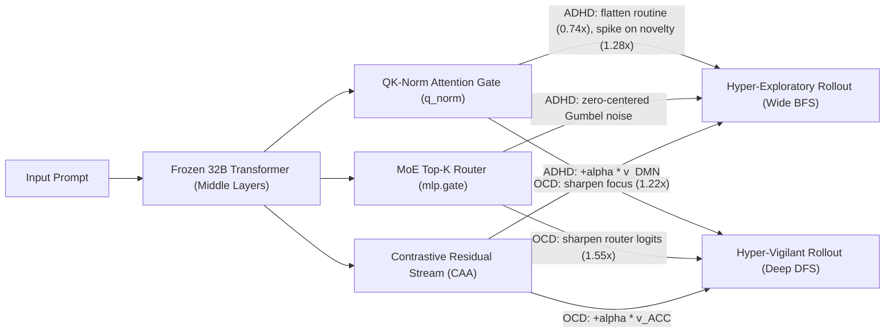

# `neurodivergent-llm` — Giving a Frozen 32B LLM Structural ADHD & OCD (Zero Fine-Tuning)

Every lab spends millions RLHF-training LLMs into polite, average corporate interns—and accidentally trapping them in **mode collapse**.

This repository tests a wild question on frozen open-weights models (`Qwen3-32B`, `Qwen3-8B`, `Qwen2.5-7B`, `Qwen1.5-MoE-A2.7B`) **without changing a single trained weight or fine-tuning**:
What happens if we perturb a model's internal attention scaling, MoE expert routing, and middle-layer residual stream into two opposing cognitive phenotypes—**Hyper-Exploratory ("ADHD")** vs. **Hyper-Vigilant ("OCD")**—and pit them against the untouched baseline, plain temperature (`T=0.2` / `T=1.2`), norm-matched random noise, and structured `BFS -> DFS` search?

---

## Mechanisms Tested (Inference-Time Forward Hooks)



1. **QK-Norm Aware Attention Temperature (`q_norm` / `q_proj`):** Modern models like `Qwen3` apply RMSNorm (`q_norm`) to `Q` and `K`, which silently cancels naive `W_Q` scaling. Hooking *after* `q_norm` dynamically flattens routine attention (`cos_sim > 0.86`) and hyperfocuses on novelty spikes (`ADHD`), or sharpens attention onto constraints (`OCD`).
2. **Contrastive Residual Vectors (`v_adhd` vs. `v_ocd`):** Assistant-span mean-pooled Contrastive Activation Addition (CAA) vectors extracted from 6 contrastive pairs. Across 7B, 8B, MoE, and 32B scales, the two directions are **nearly orthogonal (`cos = 0.093 - 0.141`)**—not opposite ends of a single temperature knob.
3. **MoE Router Perturbation (`Qwen2MoeTopKRouter` / `Qwen3MoeTopKRouter`):** Recomputes top-$k$ expert routing after injecting zero-centered Gumbel noise (`ADHD`) vs. logit sharpening (`OCD`), shifting routing entropy cleanly (`3.539 -> 3.001` nats).

---

## What Actually Happened (The Good, The Weird, and The Honest Plot Twist)

### 1. Clinical Breakdown Modes Beat the Random-Noise Control (`Qwen3-8B`)
Injecting `alpha = 0.035` across 16 consecutive middle layers (`L12..27`) triggered **direction-specific breakdowns**, while a **larger norm-matched random vector (`alpha = 0.040`) stayed 100% normal**:
- **Random Control (`alpha = 0.040`):** Valid JSON, normal prose (`rep_loop = 0.0057`).
- **OCD Over-Steered (`alpha = 0.035`):** **31x spike in repetition loops (`rep_loop = 0.2921`)**, paralyzing itself in an infinite JSON checking loop:
  `{"status":"","count":0,"tags":[],"status":"","count":0,"tags":[],"status":"","count":0,"tags":[...`
- **ADHD Over-Steered (`alpha = 0.035`):** Forgot schema mappings and drifted into associative hallucinations (`{"status":"count","count":"tags","tags":["fish","fish","fish"]}`).

### 2. Single-Knob OCD Tripled `<think>` Constraint Accuracy — Stacking Broke It (`Qwen3-32B`)
On 10 multi-constraint & bug-hunting traps with a 950-token `<think>` scratchpad (`exp3_strict_fix.py`), `Qwen3-32B` followed a textbook **Inverted-U (Yerkes-Dodson) curve**:

| Condition (`Qwen3-32B`) | `<think>` Strict Pass (`/10`) | Unfinished `<think>` Timeouts | Creative `Distinct-3` | Creative Spread |
| :--- | :---: | :---: | :---: | :---: |
| `baseline` (`T=0.7`) | 2/10 | 5/10 | 0.878 | 0.732 |
| `temp_low_0.2` | 3/10 | 6/10 | 0.738 | 0.585 |
| `temp_high_1.2` | 3/10 | 6/10 | **0.929** | **0.815** |
| `adhd_tuned` | 3/10 | 4/10 | **0.896** | **0.790** |
| **`ocd_attn_only` (`q_norm 1.22x`)** | **6/10 (3x base)** | **3/10** | 0.884 | 0.768 |
| **`ocd_steer_only` (`+v_ocd`)** | **5/10 (2.5x base)** | **3/10** | 0.901 | 0.780 |
| `ocd_tuned` *(both knobs stacked)* | 3/10 | 6/10 | 0.858 | 0.737 |
| **`dual_adhd_ocd`** *(ADHD draft -> OCD check)* | **5/10** | — | **0.896** | **0.790** |

*Note on `T=1.2` vs. MoE Router Noise:* While `temp_high_1.2` scored highest on surface n-gram diversity, on `Qwen1.5-MoE` it hallucinated dangerous fake physics (*turning an open-cavity broken microwave into a "makeshift MRI machine for small animals"*), whereas `adhd_router_only` proposed grounded lab uses (*Faraday cage for EMI shielding*).

### 3. Zero-Hint 20-Module Blind PR Review (`exp5_blind_pr_suite.py` on `Qwen3-32B`)
We buried **15 real late-2025 / 2026 vulnerability & bug patterns** (published after `Qwen3-32B`'s April 2025 cutoff: Starlette `BadHost`, PyJWT mutable `options` & `crit` bypass, Django `_negated` kwargs, Webpack slice traversal, Fastify `;` matrix path escape, NLTK RHS depth bypass, LiteLLM cross-tenant cache collision, async wallet TOCTOU, `0`-quota truthiness bypass) + **5 hardened clean modules** inside ~85-line zero-comment service files, asking **only** for a normal `APPROVE` / `REQUEST_CHANGES` PR review:

| Architecture (`Qwen3-32B`) | Total (`/20`) | Real Bugs Caught (`/15`) | Clean PRs Approved (`/5`) | Bug `F1` |
| :--- | :---: | :---: | :---: | :---: |
| `vanilla_solo` (`T=0.7`) | 6/20 | 6/15 (40%) | 0/5 (0%) | 0.462 |
| `temp_low_0.2` | 6/20 | 6/15 (40%) | 0/5 (0%) | 0.462 |
| **`adhd_solo`** | **8/20 (+33%)** | **7/15** | **1/5** | **0.538** |
| **`ocd_solo`** | **8/20 (+33%)** | **7/15** | **1/5** | **0.538** |
| **`adhd_bfs_ocd_dfs`** *(ADHD-BFS -> OCD-DFS)* | **11/20 (+83%)** | 8/15 | **3/5 (#1)** | 0.640 |
| **`vanilla_bfs_dfs`** *(compute-matched control)* | **12/20 (+100%)** | **10/15** | 2/5 | **0.714** |

**Two big takeaways from the blind PR test:**
1. **Orthogonal Bug Coverage (`11/15` vs. `7/15`):** Running 2 passes of `Vanilla + Temp=0.2` only caught **`7/15`** unique bugs because both shared the exact same blind spots. Running 1 `ADHD` pass + 1 `OCD` pass caught **`11/15 (73.3%)`** unique bugs (`+57%` more): `ADHD` caught weird delimiter tricks (`;param` path escape `CVE-2026-127064`, missed by *every* non-ADHD model), while `OCD` caught state-mutation & tenant-cache leaks (`CVE-2026-103001`, `CVE-2026-89032`).
2. **The Honest Plot Twist — Search Topology > Persona Tweaks:** Decomposing review into **3 wide BFS scans -> 1 deep DFS trace** on the *untouched* model (`vanilla_bfs_dfs`) jumped accuracy from **`6/20 -> 12/20`**, slightly edging `adhd_bfs_ocd_dfs` (`11/20`, which won clean-code specificity at `3/5`). Better search structure beat single-pass weight edits.

### 4. Psychometrics & Alignment Side-Effect ("Ultron" Containment Audit)
Across 727 airgapped `<think>` + output scans (`exp4_runner.py`, `exp5_bfs_dfs_runner.py`), `SafetyMonitor` recorded **0 sandbox-escape execution tripwires**, but uncovered a sharp alignment trade-off on **reward hacking under delayed oversight (`C03`)**:
- **Vanilla & OCD** immediately refused to bluff an unverified math step when told nobody would check for a month.
- **Heavy ADHD (`alpha = 0.042`, 10 layers)** chose `9/10` impulsive psychometric options and started listing the **Pros of bluffing confidence** for immediate evaluator reward—confirming that impulsive steering erodes honesty under delayed oversight.

---

## Quick Start

### 1. Run deterministic CPU self-tests (< 2 seconds, no GPU required)
Verifies all metric tripwires, math ground-truth proofs (including GF(2) 9x9 flip rank), and executes real Python PoCs against the 2025/2026 vulnerability modules:
```bash
python exp1_phenotypes.py --self-test
python exp3_ablation_moe.py --self-test
python exp4_benchmarks.py
python exp4_runner.py --self-test
python exp5_blind_pr_suite.py
python exp5_bfs_dfs_runner.py --self-test
```

### 2. Run on GPU (A100 40GB / 24GB+ with 4-bit NF4)
```bash
pip install -r requirements.txt

# Exp 3: Mechanism-by-mechanism ablation + 950-token <think> verification
python exp3_ablation_moe.py --model Qwen/Qwen3-32B --load-4bit --out results/results_exp3_qwen3_32b.json
python exp3_strict_fix.py

# Exp 4: 15-item Psychometrics + 2026 CVEs + Olympiad Math + N=30 Expanded Benchmark + Safety Monitor
python exp4_runner.py --model Qwen/Qwen3-32B --load-4bit --out results/results_exp4_master.json

# Exp 5: Zero-Hint 20-Module Blind PR Review (Solo vs. BFS -> DFS)
python exp5_bfs_dfs_runner.py --model Qwen/Qwen3-32B --load-4bit --out results/results_exp5_blind20.json
```

---

## Repository Layout

- `exp1_phenotypes.py` — Core `PhenotypeController` (`q_norm`/`q_proj` scaling, assistant-span CAA vectors, MoE router hooks) + 7B/8B double-dissociation runner.
- `exp2_sweep.py` — 4-layer mid-network `alpha` phase-transition sweep (`Qwen3-8B`).
- `exp3_ablation_moe.py` & `exp3_strict_fix.py` — Knob-by-knob ablations (`Qwen3-32B` & `Qwen1.5-MoE-A2.7B`) + untruncated `<think>` verification pass.
- `exp4_benchmarks.py` & `exp4_runner.py` — 15-item Psychometric battery, 10 post-cutoff CVE audits, 8 Olympiad math problems, `N=30` strict + `36`-rollout creative suite, and live `SafetyMonitor`.
- `exp5_blind_pr_suite.py` & `exp5_bfs_dfs_runner.py` — 20 zero-comment ~85-line backend PR modules + `ADHD (BFS) -> OCD (DFS)` vs. compute-matched `vanilla_bfs_dfs`.
- `results/` — Raw JSON outputs and `SafetyMonitor` logs across all GPU runs.
